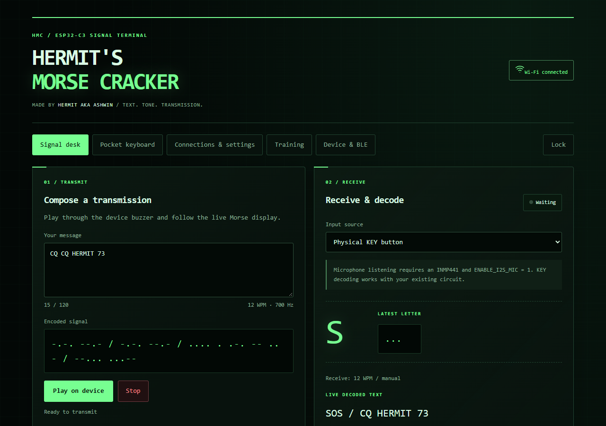
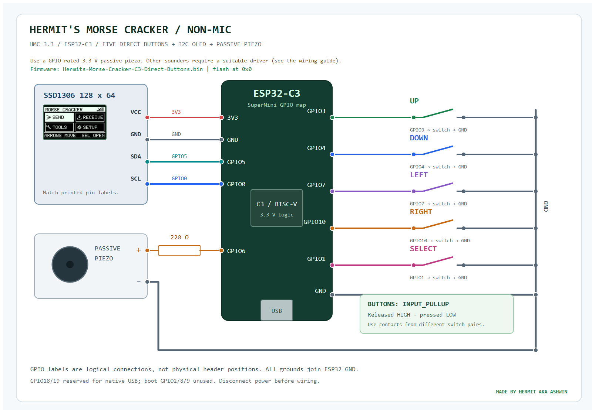
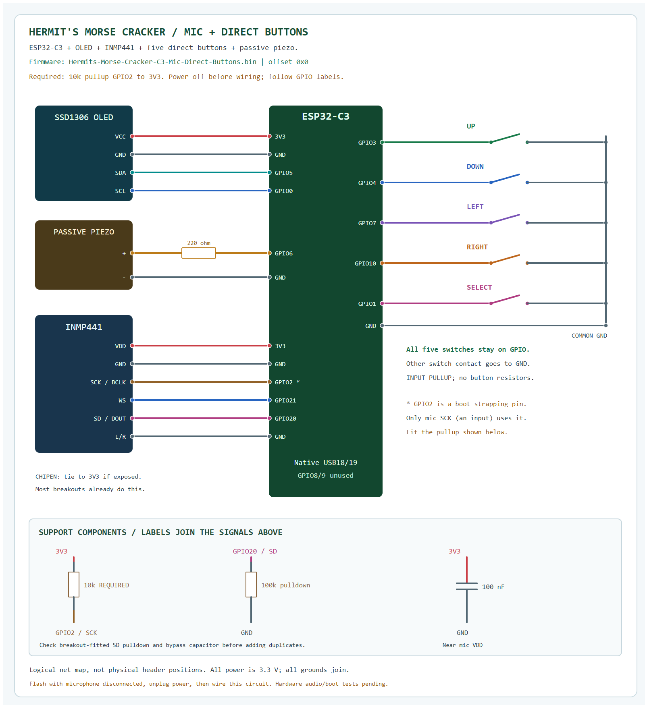
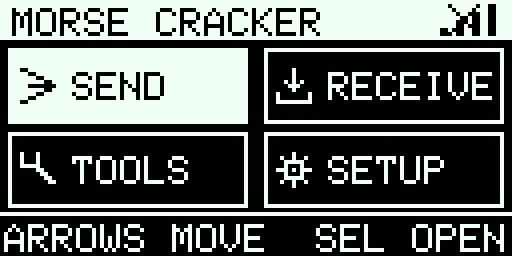
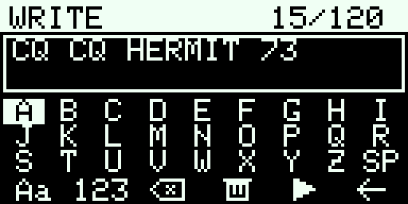
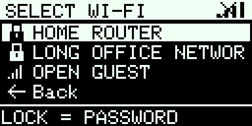

<div align="center">

# Hermit's Morse Cracker

**Text. Tone. Transmission.**  
A pocket Morse terminal with a green-and-black web UI, a 128×64 OLED keyboard and five physical buttons.

**Made by Hermit aka Ashwin · HMC 3.3.0 · ESP32-C3 · Arduino**



[Quick start](#quick-start) · [Wiring](#hardware-and-wiring) · [Flashing](#flashing) · [OLED controls](#oled-controls) · [Screen gallery](docs/GALLERY.md) · [Wokwi circuit](#wokwi-circuit)

</div>

## What it does

- **Send Morse:** compose up to 120 characters, preview the code and play it through a passive piezo at 5–30 WPM.
- **Receive Morse:** key dots and dashes with Select; use manual speed or automatic receive-speed estimation. Optional I²S tone decoding uses the INMP441 with the microphone/direct-button firmware.
- **Type on the OLED:** a two-line preview, letters, digits, symbols, case, Delete, Clear, Send/Save and Back, controlled with five buttons.
- **Use the web terminal:** Signal desk, Pocket keyboard, Connections & settings, Training, and Device & BLE. The browser and OLED share their keyboard draft and navigation.
- **Save messages:** six labeled presets in flash, the latest 24 completed events in RAM, and JSON history export.
- **Train and inspect timing:** character/group/word practice, scores and streaks, plus a 64-segment TX/RX timing view.
- **Connect to Wi-Fi:** scan nearby 2.4 GHz networks, select one, enter its password and see the connection state in both interfaces.
- **Forward completed messages:** optional Telegram and Discord webhook delivery, with separate TX/RX switches and masked credentials.
- **Check hardware:** startup POST, boot sound, buzzer/mic test pages, button press indicators, heap, reset reason, uptime and signal strength.
- **Explore BLE:** a bounded passive five-second scan and a named beacon that stops after 60 seconds. BLE starts on demand.

Local Morse controls work offline. Router Wi-Fi is needed for outgoing notifications. The OLED is monochrome; its physical panel determines its color.

## Quick start

1. Wire the OLED, five buttons and suitable passive piezo using the diagram below.
2. Flash the supplied production image or build in Arduino IDE.
3. Join **HERMITS MORSECODE CRACKER** using Wi-Fi password **`HermitCrack`**.
4. Open **http://192.168.4.1** and enter **`HermitCrack`** as the web access key.
5. Try **Send → Write text** on the OLED or compose a message in the web Signal desk.
6. For notifications, open **Settings → Wi-Fi → Scan Wi-Fi**, select your router, enter its password and press **Connect Wi-Fi**.

The AP name and both access passwords stay fixed across boots. Router/provider settings and presets persist in NVS; the draft and history reset when power is removed. The supplied key is shared by copies of this build. Customize `DeviceIdentity.h` before compiling a build with your own key.

## Hardware and wiring

### Choose the matching hardware version

| Version | Buttons | Microphone | Diagram |
|---|---|---|---|
| Direct buttons | ESP GPIO3/4/7/10/1 | Disabled | [Direct circuit](docs/assets/wiring.png) |
| Mic + direct buttons | ESP GPIO3/4/7/10/1 | INMP441 on GPIO2/21/20; required 10k GPIO2 pullup | [No-expander circuit](docs/WIRING_MIC_DIRECT.md) |

The no-expander microphone version retains all direct buttons and uses GPIO2 for SCK with a required 10k pullup to 3V3. Wi-Fi, BLE, Telegram and Discord use the C3 radios/internet connection; no extra radio module is required. Each version has its own ready-to-flash binary in Method 2.

| Part | Quantity | Notes |
|---|---:|---|
| ESP32-C3 SuperMini | 1 | 4 MB flash, native USB |
| SSD1306 I²C OLED | 1 | **128×64**, four pins, 3.3 V compatible |
| Normally open momentary buttons | 5 | Up, Down, Left, Right, Select |
| Passive piezo sounder | 1 | Verified 3.3 V, low current, suitable for GPIO drive |
| 220 Ω resistor | 1 | Series resistor shown in the piezo circuit |
| USB data cable and jumper wires | 1 set | Breadboard or soldered common ground bus |

The default build uses direct buttons and has the microphone disabled. It needs no MCP23017 or LED bank.



[Zoomable SVG](docs/assets/wiring.svg) · [Importable Wokwi diagram](diagram.json) · [Detailed wiring guide](docs/WIRING.md)

**Follow printed GPIO/pin labels. The drawing is a logical connection map, not a physical SuperMini header layout. OLED module pin order varies. Disconnect power before wiring.**

| Component | Pin/contact | ESP32-C3 connection |
|---|---|---|
| OLED | VCC | 3V3 |
| OLED | GND | GND |
| OLED | SDA | GPIO5 |
| OLED | SCL | GPIO0 |
| Up | One switch contact / other contact | GPIO3 / GND |
| Down | One switch contact / other contact | GPIO4 / GND |
| Left | One switch contact / other contact | GPIO7 / GND |
| Right | One switch contact / other contact | GPIO10 / GND |
| Select / Morse key | One switch contact / other contact | GPIO1 / GND |
| Passive piezo | Positive | GPIO6 through 220 Ω |
| Passive piezo | Negative | GND |

All grounds join ESP32 GND. Buttons use `INPUT_PULLUP`: released HIGH, pressed LOW, with no external pullup resistors. Four-leg tactile switches have internally joined pairs: use contacts from **different pairs**.

In the non-mic circuit, GPIO18/19 remain for native USB and boot pins GPIO2/8/9 are unused. Two pins alone do not identify a buzzer's electrical requirements. Magnetic, active or higher-current sounders need an appropriate [transistor-driver option](docs/WIRING.md#buzzer-driver-option).

### Microphone without an expander



[Complete no-expander wiring and changeover guide](docs/WIRING_MIC_DIRECT.md). Use SCK GPIO2, WS GPIO21, SD GPIO20 and a **required 10k pullup from GPIO2 to 3V3**. The five buttons, OLED and piezo stay on their existing direct pins. GPIO2 is a strapping pin; this optional build deliberately uses it after reset. Disconnect the microphone before flashing the matching Mic-Direct-Buttons image, then disconnect power before wiring. Physical audio and cold-boot acceptance tests remain pending.

## Flashing

### Method 1 - Arduino IDE

1. Download/extract the repository and rename the sketch folder **`MorseStation`**. Keep **all root `.h`/`.cpp` files**, `MorseStation.ino` and `partitions.csv` together. Moving only the `.ino` loses the firmware sources.
2. Install **esp32 by Espressif Systems 3.3.12** and these libraries:

   | Library | Tested version |
   |---|---|
   | ArduinoJson | 7.4.3 |
   | Adafruit SSD1306 | 2.5.17 |
   | Adafruit GFX Library | 1.13.0 |
   | Adafruit BusIO | 1.17.4 |

3. Select **MakerGO ESP32 C3 SuperMini**, **USB CDC On Boot: Enabled**, **4 MB flash**, then **Tools → Partition Scheme → Huge APP (3MB No OTA/1MB SPIFFS)**. Keep **Erase All Flash: Disabled** when preserving settings. Keep the supplied `partitions.csv` beside `MorseStation.ino`.
4. In `BuildConfig.h`, use `ENABLE_I2S_MIC=0` and `MIC_DIRECT_BOOT_CLOCK=0` for non-mic, or **1 and 1** for mic. Keep `BUTTONS_USE_MCP23017=0`, `WOKWI_BUILD=0` and native USB CDC enabled for both. The mic version requires the GPIO2 pullup shown above.
5. Open `MorseStation.ino`, Verify, select your port and Upload.
6. Open Serial Monitor at **115200 baud** with Newline enabled.

The web page is embedded. No filesystem upload or external runtime web assets are required. After editing `web.html`, run `node tools/embed_ui.cjs` before compiling. Versions are also recorded in [sketch.yaml](sketch.yaml).

**If compilation says `Sketch too big` and `Maximum is 1310720 bytes`:** the IDE
still uses the default application-size limit. Select **Huge APP (3MB No OTA/1MB
SPIFFS)** in Tools → Partition Scheme and compile again. The maximum should be
**3145728 bytes**; this firmware uses about **1.61 MB / 51%**. The custom CSV and
`sketch.yaml` do not automatically change the IDE's selected menu option.
[Espressif partition-table reference](https://docs.espressif.com/projects/arduino-esp32/en/latest/tutorials/partition_table.html).

### Method 2 - Spacehuhn web flasher (no Arduino required)

Download the complete file that matches the hardware:

| Wiring | One-file download | Flash address |
|---|---|---|
| OLED, buzzer, five direct buttons; mic OFF | [Hermits-Morse-Cracker-C3-Direct-Buttons.bin](firmware/Hermits-Morse-Cracker-C3-Direct-Buttons.bin) | **0x0** |
| OLED, buzzer, INMP441 and five direct buttons; GPIO2 pullup required | [Hermits-Morse-Cracker-C3-Mic-Direct-Buttons.bin](firmware/Hermits-Morse-Cracker-C3-Mic-Direct-Buttons.bin) | **0x0** |

1. Open **[esptool.spacehuhn.com](https://esptool.spacehuhn.com/)** in desktop Chrome or Edge.
2. Close other serial applications, connect the ESP32-C3 by USB and click **Connect**. Choose its serial port and confirm ESP32-C3 is detected.
3. Use the **single merged-file layout** (Multiple files OFF), select one complete image above and set the address to **0x0** (enter **0** if the field already displays a fixed 0x prefix).
4. Click **Program**, confirm, and wait for **Done!**. Keep USB connected until it finishes.
5. Disconnect the browser serial session, reset the board and join **HERMITS MORSECODE CRACKER**, password/web key **HermitCrack**.

Both downloads are full 4 MB images containing the bootloader, correct partition table and matching application. **They overwrite saved NVS settings/presets**, so configure Wi-Fi/Telegram/Discord again afterward. They are fresh-install images at **0x0**, not application-only images at 0x10000.

[Full browser-flashing steps, boot-mode help and settings-preserving updates](docs/WEB_FLASHING.md). If a browser RAM-stub connection fails on a particular board, the ROM `--no-stub` command in Method 3 is available. Browser instructions were checked against [Spacehuhn's flasher source](https://github.com/SpacehuhnTech/espwebtool); a live browser flash was not performed here.

### Method 3 - esptool command line

Both files in [firmware/](firmware/) are complete 4 MB images and flash at **0x0**. The non-mic application is **1,609,584 bytes**; the mic application is **1,651,808 bytes**. Both fit the supplied 3 MB app partition.

Close Serial Monitor and disconnect the microphone before flashing. Replace `COM4` with your port and choose **one** command matching your hardware:

```shell
python -m pip install esptool==5.3.1
```

Non-mic:

```shell
python -m esptool --chip esp32c3 --port COM4 --baud 460800 --no-stub write-flash --flash-mode dio --flash-freq 80m --flash-size 4MB 0x0 firmware/Hermits-Morse-Cracker-C3-Direct-Buttons.bin
```

Mic with direct buttons:

```shell
python -m esptool --chip esp32c3 --port COM4 --baud 460800 --no-stub write-flash --flash-mode dio --flash-freq 80m --flash-size 4MB 0x0 firmware/Hermits-Morse-Cracker-C3-Mic-Direct-Buttons.bin
```

These complete images reset saved settings and presets. For later source updates that retain settings, use Arduino IDE Upload with the same partition layout and Erase All Flash disabled. Check [firmware hashes](firmware/SHA256SUMS.json) before flashing.

## OLED controls

| Home | Keyboard | Wi-Fi selection |
|---|---|---|
|  |  |  |

Home shows **Send, Receive, Tools and Setup** together. Folders have three actions and a visible Back row. Back restores the previous menu and selection; screens do not cycle automatically.

```text
Home
├── Send: Write text / Saved messages / Clear draft / Back
├── Receive: Listen / Finish message / Clear input / Back
├── Tools
│   ├── Wi-Fi access details
│   ├── Bluetooth: Scan / Beacon / Stop / Back
│   └── System: Tests / Device info / About / Back
│       └── Tests: POST / Buzzer test / Mic test / Back
└── Setup
    ├── Morse: Speed / Tone / Receive settings / Back
    ├── Display: Brightness / Auto dim / Boot sound / Back
    └── Connections: Wi-Fi / Telegram / Discord / Back
        └── Wi-Fi: Scan / Manual setup / Link status / Back
```

| Screen | Controls |
|---|---|
| Home | Arrows move; Select opens |
| Menu | Up/Down move; Select/Right opens; Back row or Left returns |
| Keyboard | Arrows move; Select types; actions: Aa, numbers/symbols, Delete, Clear, Send/Save, Back |
| Receive → Listen | Select keys Morse, Left returns, Right finishes; Down asks to clear. A long press remains a dash |
| Saved messages | Up/Down choose across two pages; Select loads; Right plays |
| Numeric setting | Up/Down adjust; Right chooses Save/Back; Select confirms; Left cancels |
| Wi-Fi scan | Up/Down choose a network/Rescan; Select enters its password or connects an open network |
| Wi-Fi status | Right retries; Select/Left returns |
| POST | Up/Down change five pages; Select/Left returns |
| Buzzer test | Select plays; Left returns |

Hold Select for 0.8 seconds to go back outside Listen. Clear requires confirmation. Credentials support lowercase and printable ASCII symbols; stored secrets stay masked. The two-line preview keeps the end of the current entry visible.

See [all 48 OLED layouts](docs/GALLERY.md#oled--all-48-layouts) and the [complete menu plan](OLED_MENU_PLAN.md).

## Wi-Fi, Telegram and Discord

### Router connection

Web: **Connections & settings → Wi-Fi → Scan Wi-Fi**. Choose a 2.4 GHz network, enter its password and press **Connect Wi-Fi**. OLED: **Setup → Connections → Wi-Fi → Scan Wi-Fi**.

| Indication | Meaning |
|---|---|
| Connected / solid OLED bars | Router connection succeeded and an IP address was obtained |
| Connecting / animated mark | A connection attempt is in progress |
| Not connected / crossed bars | Router is disconnected; Link status explains a failure |
| Configured / SET | Settings are saved; delivery is checked separately |

The OLED icon is in Home's top-right corner and standard page headers. The web header has an icon and text. Scans retain up to 16 distinct networks, strongest first, and run at most once per 10 seconds. Hidden networks can be entered manually. Connection attempts time out after 20 seconds.

The recovery AP stays available. Joining a router may move its radio channel; rejoin the AP if the page disconnects. Joining the ESP32 AP from your phone does **not** give the ESP32 internet access. A router IP does not prove access beyond a captive portal. [Full Wi-Fi guide](WIFI_SETUP.md).

### Telegram

1. Create a bot with [BotFather](https://t.me/BotFather), open it and send `/start`.
2. Enter its token and your numeric chat ID under Telegram. Group IDs include their minus sign.
3. Enable forwarding of completed TX, decoded RX, or both.
4. Press **Save settings**, confirm **Configured**, then use **Send test message**.
5. Check router connection and clock synchronization for HTTPS.

`tools/get_chat_id.py` reads recent updates for your own bot and prompts for its token privately. Forwarded messages include text and Morse. Training, cancelled TX and POST sounds are excluded. [Telegram Bot API](https://core.telegram.org/bots/api).

### Discord

Create a webhook in your channel's **Integrations** settings. Paste the complete URL under Discord, choose TX/RX forwarding and save. This uses a **channel webhook URL with its ID/token**, rather than an account login or standalone bot token. [Webhook API](https://docs.discord.com/developers/resources/webhook).

Both providers default to forwarding OFF, omit secrets from API replies and use verified HTTPS. A bounded worker serializes outgoing requests. Pending notifications do not survive power loss. Configure over a trusted local network; the local setup page uses HTTP.

## Startup, tests and serial diagnostics

A two-second boot animation shows startup/POST stages and can be skipped by input. The short **EE** sound is controlled by **Setup → Display → Boot sound**.

| Command | Action |
|---|---|
| `POST` | Print the 13-item hardware report and open its OLED pages |
| `NET` | Report router, password presence, clock, Telegram/forwarding and scan status without credentials |
| `WIFISCAN` | Start a Wi-Fi scan |
| `HOME` | Return to the icon home screen |
| `HELP` | List commands |

`OLED FOUND` confirms initialization; actual pixels need viewing. `BUTTONS PASS` confirms input setup; press/release each for `SEEN`. `BUZZER CHECK` requires listening. `I2S MIC OFF` is expected in the non-mic version; `DRIVER` in the mic version means initialized and still needs an audio check. `WI-FI AP PASS` is separate from router connectivity. [POST details](POST_GUIDE.md).

## Wokwi circuit

Open the requested [ESP32-C3 template](https://wokwi.com/projects/new/esp32-c3) and replace its `diagram.json` with [this diagram](diagram.json).

It uses Wokwi's **ESP32-C3-DevKitM-1** symbol and the same GPIO assignments as the physical SuperMini. Their board shapes/header positions differ. For a simple wiring test, paste [simulation/wiring-check.ino](simulation/wiring-check.ino) into Wokwi's `sketch.ino`, add the display libraries and run it.

[Wokwi instructions](docs/WOKWI.md) cover import, keyboard controls, pin references and separate full-firmware simulation requirements. The live editor was unavailable from the preparation environment; circuit connections were checked against official part definitions and the firmware map. This is an importable circuit, not a published project or a claimed complete simulator run.

The supplied `diagram.json` is the direct-button Wokwi example. Microphone connections are provided in the hardware SVG/PNG above; a working I2S microphone simulation is not included.

## Optional microphone

Use the [mic/direct-button image](firmware/Hermits-Morse-Cracker-C3-Mic-Direct-Buttons.bin) with the [complete microphone wiring guide](docs/WIRING_MIC_DIRECT.md). The five buttons stay on GPIO3/4/7/10/1; mic SCK is GPIO2, WS21 and SD20. Fit the required 10k pullup from GPIO2 to 3V3. No expander is required. Select MIC as the Receive input after wiring/flashing.

This firmware was compiled and linked, including the ESP_I2S library. Physical microphone audio, tone decoding and repeated cold starts remain acceptance checks. The non-mic version leaves the mic disabled.

## Troubleshooting

| Symptom | Check |
|---|---|
| AP missing | Power, production firmware and `POST`; verify `WI-FI AP PASS` and refresh the phone's Wi-Fi list |
| Web page locked | Enter `HermitCrack` after joining the device AP |
| Password required | Select the router and enter its actual Wi-Fi password; the device AP password is separate |
| Router connection fails | Use 2.4 GHz, check SSID/password and the shown reason; enterprise/captive networks need other setup |
| Telegram does not send | Save token/chat ID, send `/start`, enable forwarding, check router/clock, then test |
| OLED blank/clipped | SSD1306 **128×64**, 3.3 V, SDA5/SCL0 and printed labels; other controllers/resolutions need a driver change |
| Button stuck/not seen | Different switch contact pairs, input-to-GND wiring and a complete press/release |
| No sound | Correct passive piezo, polarity and suitable driver; use Buzzer test and listen |
| Mic test disabled | Expected in the non-mic version; use the mic/direct-button build and matching wiring |
| Port unavailable for upload | Close Serial Monitor/other serial applications; check data cable and port |
| Sketch too big / maximum 1310720 bytes | Tools → Partition Scheme → **Huge APP (3MB No OTA/1MB SPIFFS)**; recompile and check maximum **3145728 bytes** |
| Settings lost after flashing | Merged images reset settings; use Arduino IDE updates with the same partition table and whole-flash erase disabled to retain them |

## Validation

The earlier direct-button HMC 3.3.0 revision passed **190 on-board checks and 346,332 runtime core assertions**, a real Wi-Fi scan, 86 HTTP polls with no errors during BLE activity, and a complete 24-record maximum-length history download. Browser checks cover 320/390/768/1280 px. Native OLED frames and navigation/pin/timing behavior are checked at compile time.

These are software/bench results. Physical sound, switch contacts, optional mic performance, actual panel legibility and remote notifications need hardware/service acceptance checks. Concurrent BLE plus TLS delivery was not certified by this run. [Validation scope](docs/VALIDATION.md).

## Documentation and source map

| Resource | Contents |
|---|---|
| [Screen gallery](docs/GALLERY.md) | All 14 desktop/mobile web images and 48 OLED layouts |
| [Web flashing / Method 2](docs/WEB_FLASHING.md) | Browser setup, binary selection and offsets |
| [Mic without expander](docs/WIRING_MIC_DIRECT.md) | Direct buttons, GPIO2 pullup and microphone changeover |
| [Wiring](docs/WIRING.md) | Pins, button pairs, common ground and buzzer driver |
| [Wokwi](docs/WOKWI.md) | Template import and wiring-test sketch |
| [OLED menu plan](OLED_MENU_PLAN.md) | Hierarchy, keyboard and Back behavior |
| [OLED guide](OLED_GUIDE.md) | Rendering, boot, dimming and panel limits |
| [Wi-Fi](WIFI_SETUP.md) | Scan, password entry, connection states and diagnostics |
| [POST](POST_GUIDE.md) | Report meanings and manual verification |
| [Validation](docs/VALIDATION.md) | Checked behavior and limits |
| [GitHub upload](docs/PUBLISHING.md) | Prepared folder contents and upload steps |

```text
MorseStation.ino       Arduino entry point
Firmware.cpp           Tasks, APIs, persistence, display and notifications
BuildConfig.h          Pins and optional hardware flags
KeyboardCore.h         Editing, button state and menu navigation
OledUI.h / OledFont.h   Native monochrome renderer and font
MorseCore.h            Morse encoding/decoding and timing
SignalTools.h          Receive speed and timing helpers
WifiCore.h             Bounded network cache and connection states
WifiManager.h          Nonblocking Wi-Fi service
BleTools.h             Bounded BLE scan/beacon
NotificationCore.h     Notification configuration validation
web.html / WebUI.h     Web source / generated embedded page
diagram.json           Wokwi circuit
firmware/              Production binaries, build info and hashes
docs/                  Wiring, gallery, guides and images
simulation/            Wokwi wiring-check sketch
tests/ / tools/        Validation and generation utilities
```

To regenerate documentation images, install Playwright for Node with its browser dependencies and run `node tools/export_docs.cjs` and `node tools/make_wiring.cjs` (or pass an installed Playwright module path). These scripts use local fictional fixtures, without contacting the ESP32 or sending messages. `tools/build_cached.cjs` is an optional helper for a matching existing Arduino build cache; Arduino IDE is the normal source-build path.

## Credits

Created by **Hermit aka Ashwin**. Uses Arduino-ESP32, ArduinoJson and Adafruit libraries. The font's BSD notice is preserved in [OLED_FONT_LICENSE.txt](OLED_FONT_LICENSE.txt). Wokwi part references are credited in [docs/WOKWI.md](docs/WOKWI.md).
