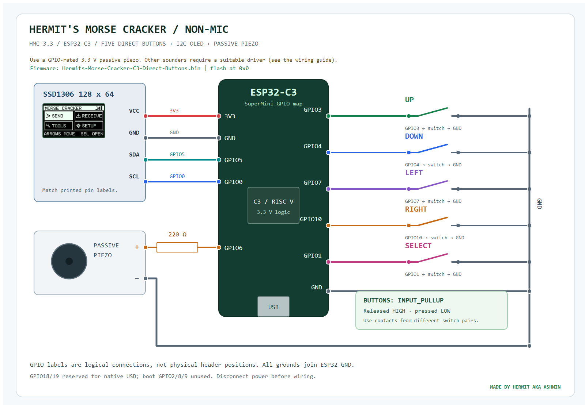

# Wiring / direct-button build

[README](../README.md) · [Wokwi circuit](../diagram.json) · [SVG](assets/wiring.svg) | [Checked netlist](assets/wiring.json)

This is the **direct-button / microphone-OFF** circuit. Download its matching
[web-flash image](../firmware/Hermits-Morse-Cracker-C3-Direct-Buttons.bin).
The [microphone/direct-button circuit](WIRING_MIC_DIRECT.md) adds the INMP441
and its support components using a separate diagram and matching firmware.

The diagram uses a logical ESP32-C3 GPIO map. Match the board's printed GPIO
labels and the OLED's printed terminal labels. SuperMini and DevKitM-1 header
positions differ. Switch off USB/external power while assembling.

## OLED

Use an SSD1306 **128×64 I²C** module compatible with 3.3 V power and logic.
VCC → 3V3, GND → GND, SDA → GPIO5, SCL → GPIO0. Pin order varies by module.
Firmware probes 0x3C/0x3D. A different controller or 128×32 panel requires a
matching firmware configuration; an I²C ACK does not identify resolution.

## Buttons

| Button | GPIO-side contact | Other contact |
|---|---|---|
| Up | GPIO3 | GND |
| Down | GPIO4 | GND |
| Left | GPIO7 | GND |
| Right | GPIO10 | GND |
| Select / Morse key | GPIO1 | GND |

All five inputs use internal pullups. Released = HIGH; pressed = LOW. No switch
connects to 3V3/5V. Four-leg tactile switches have two internally joined contact
pairs. Use one pin from each different pair; verify with continuity if uncertain.
In Wokwi, contact `1.l` is on the GPIO net and `2.r` is on common GND.

## Passive piezo

The default diagram shows **GPIO6 → 220 Ω → passive piezo +**, with piezo − to
GND. Use a verified low-current, 3.3 V compatible piezo suitable for GPIO drive.
The resistor is nonpolar. Wokwi's piezo pin 2 is positive and pin 1 is negative.

Two pins and a small casing do not establish voltage/current/type. An active
buzzer has its own oscillator and will not reproduce arbitrary tone frequencies
like a passive piezo. A magnetic sounder/speaker must not be assumed GPIO-safe.

## Buzzer driver option

For a suitable sounder requiring a driver, retain GPIO6 as the control and use
the following low-side circuit, sized for that sounder's rating:

| Connection | Destination |
|---|---|
| GPIO6 | 1 kΩ resistor, then NPN base |
| NPN emitter | Common GND |
| NPN collector | Buzzer − |
| Buzzer + | Its rated supply |
| 10 kΩ resistor | NPN base to GND |
| Magnetic sounder flyback diode | Cathode/banded end to + supply; anode to collector |

Choose an appropriately rated transistor, such as a suitable PN2222A/BC337,
and verify its actual package pinout. Supply and ESP32 grounds join; the supply
does not connect to the GPIO. This alternative is not the direct-piezo circuit
rendered in `diagram.json`.

## Reserved pins and optional microphone

This wiring leaves native USB GPIO18/19 and boot GPIO2/8/9 unused. GPIOs for
OLED, buzzer and the five buttons are distinct. Keep USB CDC enabled on the
physical SuperMini.

Microphone support is OFF by default. To retain all five direct buttons, use
[the no-expander mic build](WIRING_MIC_DIRECT.md): SCK GPIO2 with required 10k
pullup, WS21 and SD20. Unlike the default, it deliberately uses a strapping pin.
GPIO1 stays dedicated to Select; microphone SD uses GPIO20. Flash the matching
variant with the microphone disconnected, then remove power before attaching it.

## First power-on

1. Check power polarity, common GND and no unintended shorts.
2. Flash production firmware and inspect serial `POST` at 115200 baud.
3. Check the actual OLED pixels and four-icon Home layout.
4. Press/release all five buttons; POST should mark each SEEN.
5. Open Tools → System → Tests → Buzzer test and listen.
6. Use `NET` or Wi-Fi Link status to distinguish router connection from AP startup.

The firmware can detect initialization/observed button cycles. It cannot prove
sound quality, electrical buzzer presence or actual panel pixel quality.
