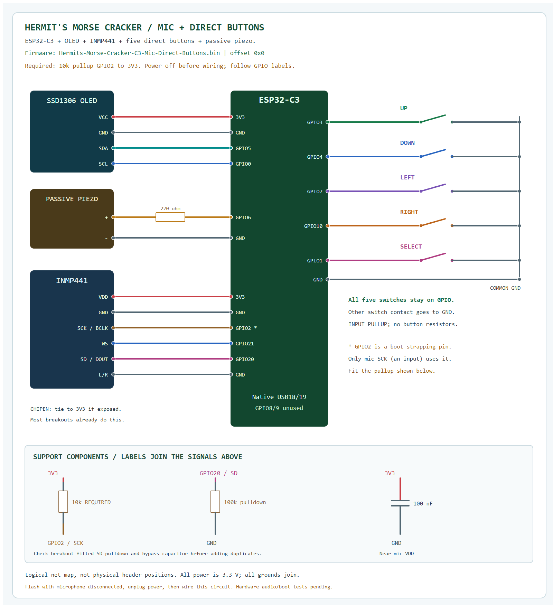

# Microphone with five direct buttons, without an expander

[README](../README.md) | [Browser flashing](WEB_FLASHING.md)

Use **Hermits-Morse-Cracker-C3-Mic-Direct-Buttons.bin** for this circuit. It enables
INMP441 audio decoding and retains all five direct buttons, the OLED, piezo,
native USB and existing software features. No MCP23017 is required.

The tradeoff is using **GPIO2**, a boot strapping pin, for the microphone's clock.
Fit a **10 kohm resistor from GPIO2 to 3V3**. Only the microphone's **SCK input**
attaches to this signal; do not put SD or a button there. Espressif recommends
pulling GPIO2 high to avoid glitches during reset. After reset it can operate as
normal GPIO. [ESP32-C3 datasheet, Boot Configurations](https://www.espressif.com/sites/default/files/documentation/esp32-c3_datasheet_en.pdf).

## Connection diagram

[Zoomable SVG](assets/wiring-mic-direct.svg) | [Checked netlist](assets/wiring-mic-direct.json)

This is a physical hardware schematic, not a Wokwi microphone simulation.
Follow printed GPIO and module labels; SuperMini header and OLED pin order vary.

## Microphone connections

| INMP441 / component | Connection |
|---|---|
| VDD / VCC | **3V3**, never 5 V |
| GND | Common ESP32 GND |
| SCK / BCLK | **GPIO2** |
| WS / LRCLK | **GPIO21** |
| SD / DOUT | **GPIO20** |
| L/R | GND (left channel) |
| CHIPEN, if exposed | 3V3; most modules already connect it |
| **10 kohm pullup, required** | **GPIO2 to 3V3** |
| 100 kohm SD pulldown | GPIO20 to GND, if not already fitted |
| 100 nF bypass capacitor | Mic VDD to GND, near microphone; if not fitted |

Use short I2S leads and a common ground. The INMP441 manufacturer specifies the
SD pulldown and local bypass capacitor. Inspect the breakout for fitted parts.
[Manufacturer application note](https://invensense.tdk.com/wp-content/uploads/2015/02/High-Performance-Digital-MEMS-Microphone-Simple2.pdf).

## Existing connections stay the same

| Component | GPIO | Other connection |
|---|---|---|
| OLED SDA | 5 | VCC 3V3, GND common |
| OLED SCL | 0 | Shared OLED power/ground |
| Up button | 3 | Other contact to GND |
| Down button | 4 | Other contact to GND |
| Left button | 7 | Other contact to GND |
| Right button | 10 | Other contact to GND |
| Select / Morse key | 1 | Other contact to GND |
| Suitable passive piezo + | 6 through 220 ohms | Piezo - to GND |

GPIO18/19 remain dedicated to native USB; GPIO8/9 are unused. GPIO20/21 are
allocated to the microphone, so **do not connect an external UART adapter**.
Use native USB with **USB CDC On Boot: Enabled**. The non-mic build leaves GPIO2 unused; this mic build deliberately uses it.

## Flash and connect

1. Disconnect USB and all other power. Disconnect the microphone completely.
2. With the microphone still disconnected, reconnect USB and flash
   [Hermits-Morse-Cracker-C3-Mic-Direct-Buttons.bin](../firmware/Hermits-Morse-Cracker-C3-Mic-Direct-Buttons.bin)
   at **0x0**. The complete image resets saved Wi-Fi/provider settings and presets.
3. Disconnect USB/power again. Install the required 10 kohm pullup and connect the
   microphone as above. Retain the five direct button connections.
4. Reconnect power. Check the AP and OLED, then press/release every button.
5. Serial `POST` must report **Direct buttons** and mic **SCK GPIO2, WS GPIO21,
   SD GPIO20**, plus the GPIO2 pullup reminder. DRIVER means initialized, not
   proof that the microphone is present.
6. Open the microphone test and play a steady tone matching the configured
   frequency. Check that level/tone confidence changes, then decode known Morse.
7. Verify several power-off/cold-start and Reset cycles with the mic attached.
   Do not call this hardware accepted until buttons, boot and audio pass.

Previous firmware may use a different pin map. Keep the microphone disconnected
until the matching image is installed. Both supplied images are complete
fresh-install files at 0x0 and reset settings. To retain settings on a later
source update, use Arduino IDE with the same partition layout and whole-flash
erase disabled.

## Build from source

In `BuildConfig.h`, set `ENABLE_I2S_MIC=1`, `BUTTONS_USE_MCP23017=0` and
`MIC_DIRECT_BOOT_CLOCK=1`. Keep `WOKWI_BUILD=0`, native USB enabled, 4 MB flash
and the README's 3 MB application partition settings. The guard rejects enabling
the old GPIO1 microphone map alongside direct Select.

The cached-toolchain builder supports `--mic-direct`. Metadata in [mic-direct/build-info.json](../firmware/mic-direct/build-info.json)
records the selected defines and pins. Compilation and layout checks do not
replace physical microphone, cold-boot and sound verification.
